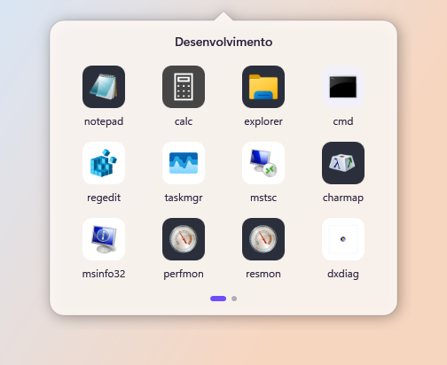
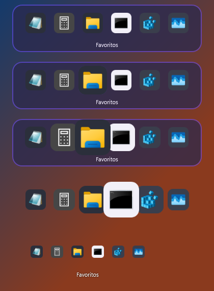
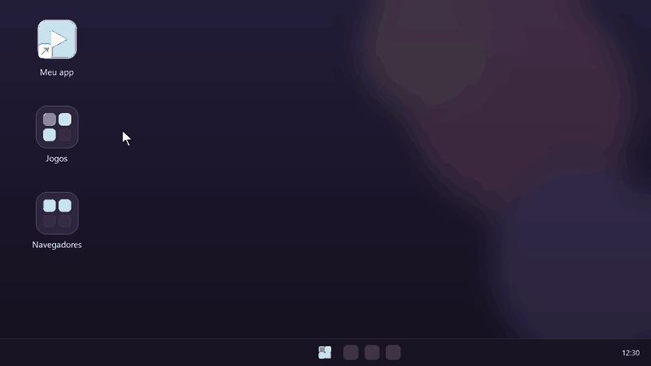
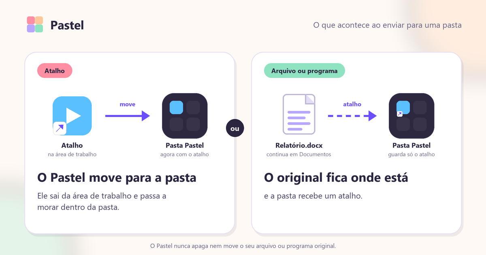
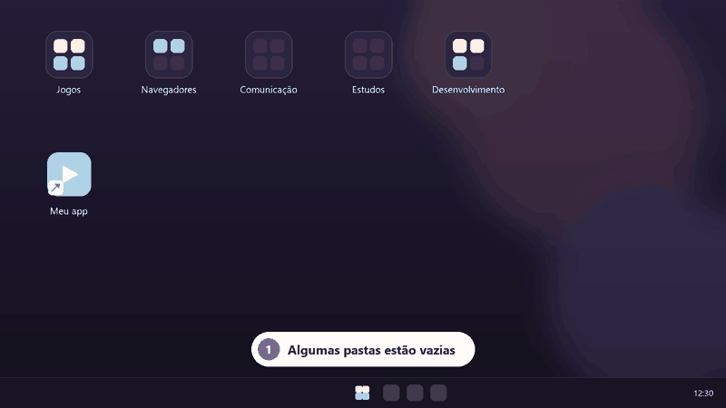
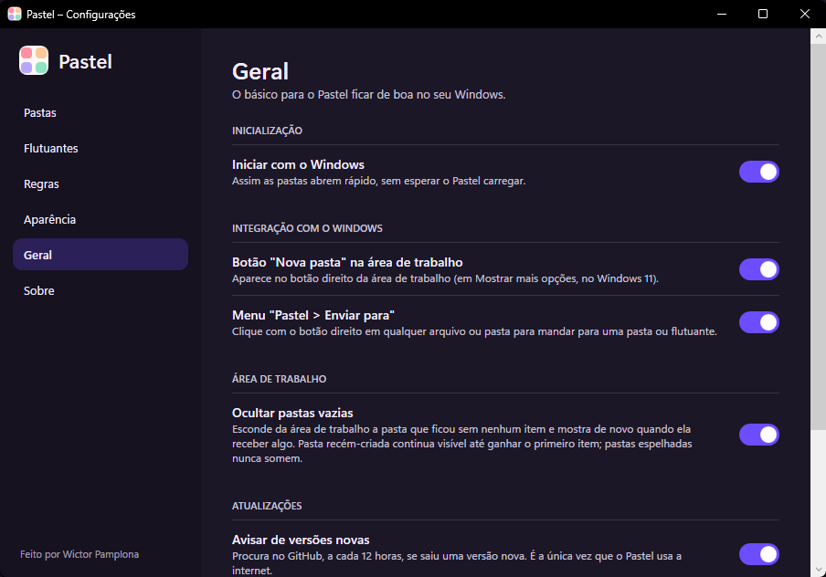

<p align="center">
  
</p>

<h1 align="center">Pastel</h1>

<p align="center"><strong>A pasta do celular, no seu PC.</strong></p>

<p align="center">
  <a href="https://github.com/WamanaDev/pastel/releases/latest"></a>
  <a href="https://github.com/WamanaDev/pastel/releases"></a>
  <a href="LICENSE"></a>
  
  <a href="https://wamanadev.github.io/pastel/"></a>
</p>

<p align="center">
  <a href="https://github.com/WamanaDev/pastel/releases/latest/download/Pastel-Setup.exe"><b>Baixar para Windows</b></a>
  &nbsp;·&nbsp;
  <a href="https://github.com/WamanaDev/pastel/releases/latest/download/pastel-linux-x64.tar.gz"><b>Baixar para Linux (KDE)</b></a>
  &nbsp;·&nbsp;
  <a href="https://wamanadev.github.io/pastel/">Site</a>
</p>

---

O Pastel junta seus apps em pastas na área de trabalho, do jeito que o celular faz. Arraste os atalhos pra dentro,
dê dois cliques e um balão abre junto do ícone. Grátis, sem conta e sem internet.

<p align="center">
  
  &nbsp;&nbsp;
  
</p>

> **Beta.** O Pastel ainda tá em beta, então pode ter um bug ou outro escondido. Se achar um,
> [abra uma issue](https://github.com/WamanaDev/pastel/issues).

## O que faz

- **Pastas** na área de trabalho, com um ícone que mostra a miniatura 2x2 dos apps de dentro. Dois cliques abrem um
  **balão com a ponta apontando para o ícone**. Mais de 12 apps vira página (roda do mouse, setas ou pontinhos).
- **Os atalhos saem da bagunça e voltam quando você quiser.** Soltar um atalho numa pasta o move para um lugar
  guardado pelo Pastel; remover da pasta, ou excluí-la, devolve o atalho.
- **Pastas espelhadas** (Windows): mostram o conteúdo de uma pasta de verdade, como Downloads, sempre atualizado. Os arquivos
  não saem de lá e nada é apagado.
- **Regras automáticas** (Windows): arquivos novos na área de trabalho, por extensão e/ou parte do nome, vão sozinhos para
  uma pasta ou flutuante. É o mesmo movimento reversível de arrastar.
- **Ocultar pastas vazias** (Windows, opcional em Configurações > Geral): a pasta vazia sai da área de trabalho e volta
  sozinha quando recebe um item. Pasta recém-criada fica visível até ganhar o primeiro item, e pasta espelhada nunca some.
- **Flutuantes**: barras de apps soltas na área de trabalho, encaixadas na grade de ícones. Tamanho dos ícones
  (mínimo a grande), com vidro ou sem fundo, com ou sem nome, e efeito do mouse (nenhum, destaque no ícone ou
  "quanto mais perto do mouse, maior", como um dock).
- **Botão direito em qualquer atalho, arquivo, programa ou pasta → Pastel → Enviar para pasta ou flutuante**, ou criar
  uma nova. Atalhos são movidos para a pasta; o resto ganha um atalho lá dentro e o original fica onde está.
- **Ícones padronizados** no estilo chapado arredondado, sem bordas esquisitas. Ícones pequenos ou com margem
  (como os de jogos da Steam) preenchem o quadrado inteiro.
- **Segue o seu tema**: claro, escuro e a cor de destaque do sistema (ou o violeta do Pastel). Animações opcionais.
- **Janela de configurações** para pastas, flutuantes, aparência e o básico.

## Instalar

### Windows 10 e 11

Baixe o `Pastel-Setup.exe` na [página de versões](https://github.com/WamanaDev/pastel/releases/latest) e execute.
O instalador tem ~48 MB e já leva o .NET dentro: não baixa nada, funciona sem internet e não pede administrador
(instala só para o seu usuário). Ao desinstalar, os atalhos que estavam nas pastas voltam para a área de trabalho e
as pastas do Pastel são apagadas.

O Windows pode avisar "editor desconhecido", porque o instalador ainda não é assinado digitalmente. Clique em
**Mais informações** e depois em **Executar assim mesmo**. As impressões digitais estão no `SHA256SUMS.txt` de cada versão.

### Linux (KDE Plasma)

```
tar xzf pastel-linux-x64.tar.gz
cd pastel-linux-x64
./install.sh
```

Não usa `sudo`. Leia o [`linux/README.md`](linux/README.md): ele diz o que foi provado num Linux de verdade e o que
ainda precisa de um KDE para ser confirmado.

## Como usar (Windows)

- **Botão direito na área de trabalho → Mostrar mais opções → Pastel → Nova pasta / Novo flutuante / Configurações.**
  Também há o ícone na bandeja (duplo clique abre as configurações).
- **Duplo clique** na pasta abre o balão. Arrastar atalhos para o ícone (ou para dentro do balão) os adiciona.
- **Renomear, mover e excluir a pasta** é direto no Explorer (F2, arrastar, Delete); o Pastel acompanha.
- **Botão direito no balão**: adicionar apps, renomear e excluir a pasta. Num app dentro dele: remover ou abrir o local.
- **Enviar para**: botão direito em qualquer atalho, arquivo, programa ou pasta → Pastel (veja abaixo).

### Enviar para uma pasta pelo botão direito

<p align="center"></p>

1. Clique com o botão direito no atalho, arquivo, programa ou pasta. No Windows 11, escolha **Mostrar mais opções**.
2. Vá em **Pastel > Enviar para pasta** (ou **Enviar para flutuante**) e escolha a pasta, por exemplo *Jogos*.
   **Novo flutuante…** cria um na hora.
3. Pronto. Se era um **atalho** (`.lnk` ou `.url`), ele sai da área de trabalho e entra na pasta. Se era um arquivo,
   programa ou pasta, a pasta do Pastel recebe um atalho e **o original fica onde está**.

<p align="center"></p>

### Ocultar pastas vazias

<p align="center"></p>

1. Abra **Configurações > Geral** (botão direito na área de trabalho > Pastel > Configurações, ou duplo clique no ícone da bandeja).
2. Em **Área de trabalho**, ligue **Ocultar pastas vazias**.
3. As pastas sem itens saem da área de trabalho. Quando você enviar ou arrastar um item para uma delas, ela volta sozinha.
4. Pasta recém-criada fica visível até ganhar o primeiro item, e pasta espelhada nunca some. Desligou a opção? Todas voltam.

<p align="center"></p>

Cada pasta é um arquivo `.wfgroup` na área de trabalho, com ícone gerado. Não é um `.lnk`, então **não tem a setinha
de atalho**. O tipo de arquivo é registrado só para o seu usuário (`HKCU`) e usa o próprio arquivo como ícone.

As pastas não aparecem em "Recentes" do Menu Iniciar: o tipo de arquivo pede ao Windows para não listar
(`NoRecentDocs`), o Pastel fica fora dos apps mais usados (`NoStartPage`) e as entradas que o Explorer criar
mesmo assim são apagadas logo depois de abrir.

**Atualizações:** de tempos em tempos o Pastel consulta a página de versões do GitHub e avisa na bandeja se saiu uma nova. Se você aceitar, ele baixa o instalador, confere o SHA-256 e atualiza em silêncio. É a única conexão de rede do app e dá para desligar em Configurações > Geral.

Os dados ficam em `%AppData%\Pastel` (`config.json`, os atalhos movidos em `Grupos\` e, com *Ocultar pastas vazias*
ligado, os arquivos das pastas escondidas em `Ocultas\`).

## Novidades da 0.1.2

- **Pastel > Enviar para pasta / flutuante** no botão direito, para atalhos, arquivos, programas e pastas. Antes, o
  atalho podia ficar na área de trabalho e *Novo flutuante…* não abria. Os dois foram corrigidos.
- **Ocultar pastas vazias** em Configurações > Geral.
- **Ícones** mais bem ajustados: os pequenos ou com margem agora preenchem o quadrado.
- O código do app Windows foi para a pasta `windows/`.

## Limitações conhecidas

- O Pastel precisa estar rodando para a pasta abrir o balão; se não estiver, o próprio duplo clique o inicia (o
  primeiro balão demora um pouco mais). Use *Iniciar com o Windows* nas configurações.
- No Windows 11, o menu do Pastel fica em *Mostrar mais opções* (o menu novo do Explorer não aceita itens de terceiros).
- Só **atalhos** (`.lnk` e `.url`) saem da área de trabalho. Arquivo, programa ou pasta não é movido: a pasta do Pastel
  recebe um atalho, e para tirar o original de lá você move ou apaga por conta própria.
- Com *Ocultar pastas vazias*, a pasta vazia some da área de trabalho e só volta quando recebe um item. Para vê-la sem
  item, desligue a opção.
- Se mover o `.exe` de lugar, abra-o uma vez: o registro do tipo de arquivo é atualizado.
- Atalhos da área de trabalho pública (`C:\Users\Public\Desktop`) não saem de lá sem permissão de administrador;
  nesse caso só são referenciados.
- No Linux, a grade de ícones do Plasma não pode ser lida, e na sessão Wayland o balão abre no meio da tela.
  Detalhes em [`linux/README.md`](linux/README.md).

## Compilar

**Windows** (SDK do .NET 10):

```
dotnet run --project windows
dotnet publish windows\Pastel.csproj -c Release -r win-x64 --self-contained true -p:DebugType=None -o publish\win-x64-sc
```

O instalador é feito com o [Inno Setup 6](https://jrsoftware.org/isinfo.php):

```
ISCC installer\Pastel.iss        # gera installer\Output\Pastel-Setup.exe
```

**Linux**: veja [`linux/README.md`](linux/README.md).

## Estrutura

| Pasta | O que tem |
|---|---|
| `windows/` | O Pastel para Windows (WPF, .NET 10), com o `Pastel.csproj` |
| `linux/` | O Pastel para Linux/KDE (Avalonia), com projeto e README próprios |
| `installer/` | O script do instalador do Windows (Inno Setup) |
| `brand/` | O símbolo em SVG e o guia de marca |
| `docs/` | O site (GitHub Pages) |

## Licença

[MIT](LICENSE). Feito por Wictor Pamplona. O Pastel é grátis e vai continuar.

<sub>Este app se chamava WFolder. Ao abrir o Pastel pela primeira vez, a configuração e os atalhos de
`%AppData%\WFolder` são copiados para `%AppData%\Pastel`; a pasta antiga não é apagada.</sub>
